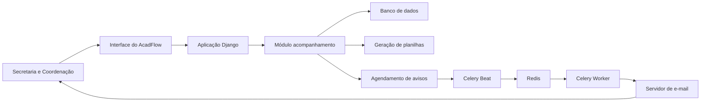
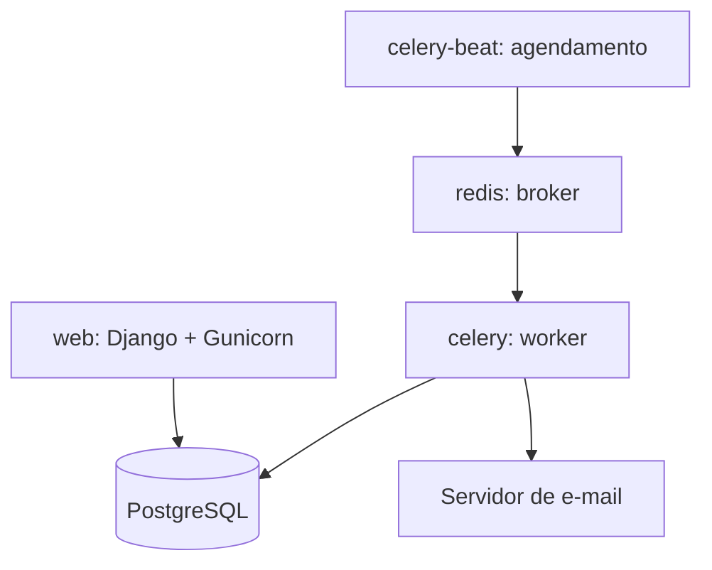
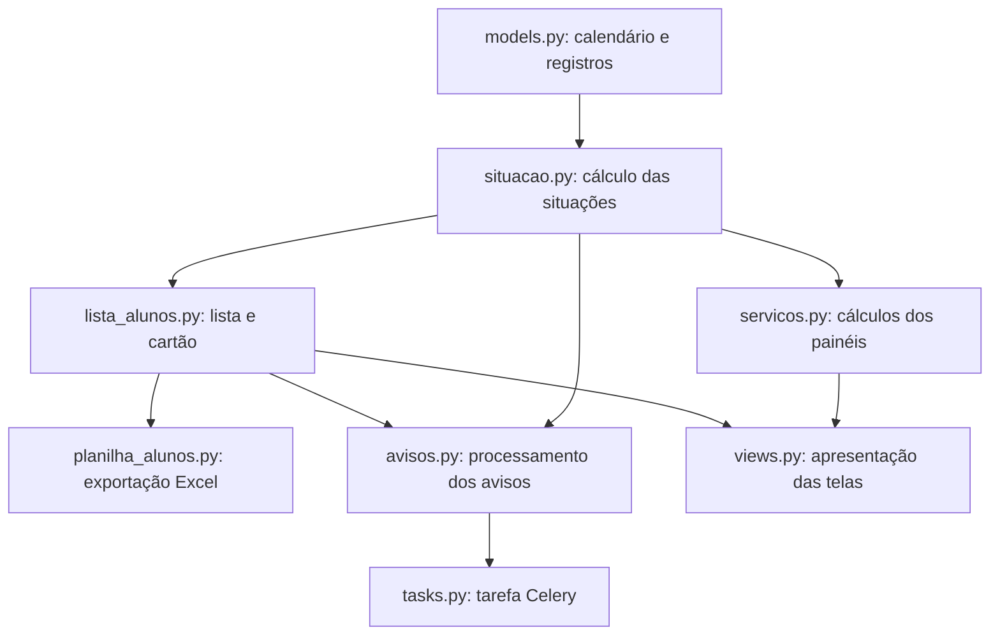
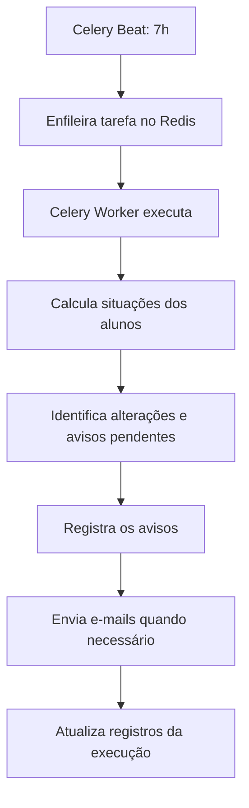

# Documento Técnico: Módulo de Acompanhamento Acadêmico

**Projeto:** AcadFlow – Sistema de Gestão de Processos do Programa de Pós-Graduação em Engenharia da Computação (PPGEC) da UPE  
**Módulo:** Acompanhamento Acadêmico  
**Equipe:** E4  
**Versão do sistema:** 1.4.1  
**Data de referência:** 21/11/2026  
**Repositório principal:** [ldhonorato/PPGEC_rec](https://github.com/ldhonorato/PPGEC_rec)  
**Fork da equipe:** [gustavosouto/PPGEC_rec](https://github.com/gustavosouto/PPGEC_rec)

Este documento apresenta a organização técnica do módulo de Acompanhamento Acadêmico, incluindo tecnologias, arquitetura, estrutura do código, configuração, execução, testes, integração contínua e procedimentos de manutenção.

O documento foi elaborado para permitir que uma equipe que não participou do desenvolvimento consiga compreender a implementação e dar continuidade ao projeto.

## Histórico de alterações

Este documento evolui a documentação técnica existente do módulo.

| Data | Alteração |
|---|---|
| 02/11/2026 | Documento criado com a primeira entrega completa do módulo: lista por marco, planilha, aviso diário, calendário e painéis. |
| 03/11/2026 | Módulo disponibilizado em produção na versão 1.4.0, com as chaves de ativação desligadas. |
| 09/11/2026 | Inclusão do Painel por Professor, ajustes nas taxas do Painel de Sucesso por Turma e fixação das versões das dependências. |
| 16/11/2026 | Atualização para a versão 1.4.1: compatibilidade entre Redis e Kombu, conferência das dependências durante o build, reorganização do acesso ao Dashboard e ajustes de interface. |
| 21/11/2026 | Revisão do documento técnico, detalhamento das dependências, inclusão do funcionamento do ensaio de produção, atualização das orientações de CI/CD e consolidação dos documentos complementares. |

## 1. Visão geral

O módulo de Acompanhamento Acadêmico amplia o AcadFlow com funcionalidades para acompanhamento de prazos dos alunos de mestrado e doutorado e consulta de indicadores acadêmicos e administrativos.

O módulo foi desenvolvido como um aplicativo Django integrado à estrutura existente do AcadFlow.

Sua ativação é controlada por variáveis de ambiente. Por padrão, o módulo e o serviço de avisos permanecem desligados, permitindo que sua instalação não altere o comportamento do sistema até que a equipe responsável decida ativá-los.

### 1.1. Telas e serviços

| Tela ou serviço | Endereço ou localização |
|---|---|
| Página de Acompanhamento | `/acompanhamento/` |
| Cartão de alunos irregulares | Página inicial do sistema |
| Lista de alunos por marco e planilha | `/coordenacao/alunos/` |
| Painel de Sucesso por Turma | `/acompanhamento/painel-sucesso-turma/` |
| Painel de Processos | `/acompanhamento/processos/` |
| Painel de Docentes | `/acompanhamento/docentes/` |
| Painel por Professor | `/acompanhamento/professores/` |
| Calendário de Marcos | `/acompanhamento/calendario-marcos/` |
| Dashboard | `/coordenacao/dashboard/` |
| Aviso diário | Tarefa Celery executada às 7h, horário de Recife |

O Dashboard já existia no sistema. Desde a versão 1.4.1, seu acesso está integrado à página de Acompanhamento, por meio de um cartão.

## 2. Repositórios e organização do desenvolvimento

O projeto utiliza dois repositórios principais no GitHub:

| Repositório | Finalidade |
|---|---|
| [ldhonorato/PPGEC_rec](https://github.com/ldhonorato/PPGEC_rec) | Repositório principal do projeto, mantido pelo responsável institucional. |
| [gustavosouto/PPGEC_rec](https://github.com/gustavosouto/PPGEC_rec) | Fork utilizado pela equipe E4 para desenvolver e integrar as alterações da disciplina. |

Na data de referência deste documento, a versão 1.4.1 está presente na branch `main` do repositório principal e na branch `develop` do fork da equipe.

### 2.1. Fluxo de desenvolvimento

O fluxo de integração utilizado no projeto é:

1. Desenvolvimento das funcionalidades na branch `develop` do fork da equipe.
2. Integração das alterações na branch `homolog` do fork.
3. Encaminhamento para a branch `stage` do repositório principal.
4. Integração final na branch `main` do repositório principal.

Os dois últimos merges dependem da aprovação do responsável pelo repositório principal.

O fluxo deve ser respeitado para evitar que alterações ainda não homologadas sejam incorporadas diretamente à versão de produção.

## 3. Tecnologias e dependências

### 3.1. Tecnologias utilizadas

| Tecnologia | Versão ou referência | Finalidade |
|---|---|---|
| Python | 3.11 no CI; consultar guia local para desenvolvimento | Linguagem principal do backend. |
| Django | 5.2 | Framework web e gerenciamento das funcionalidades do sistema. |
| PostgreSQL | 16 no CI | Banco de dados utilizado no ambiente de produção e nos testes de integração. |
| SQLite | Conforme configuração local | Banco de dados para desenvolvimento local. |
| Celery | 5.4.0 | Execução de tarefas assíncronas. |
| Redis | 6.1.0 (redis-py) | Transporte de mensagens e broker utilizado pelo Celery. |
| Kombu | 5.6.2 | Camada de comunicação utilizada pelo Celery. |
| django-celery-results | 2.5.1 | Integração de resultados de tarefas Celery com Django. |
| WhiteNoise | 6.4.0 | Disponibilização de arquivos estáticos. |
| Gunicorn | 26.2.0 | Servidor de aplicação WSGI utilizado no ambiente de produção. |
| psycopg2-binary | 2.9.10 | Driver de conexão com PostgreSQL. |
| openpyxl | 3.1.5 | Geração de planilhas Excel. |
| xlrd | 2.0.1 | Leitura de planilhas em formatos compatíveis. |
| python-dotenv | 1.0.0 | Leitura de variáveis de ambiente a partir de arquivos `.env`. |
| django-storages | 1.14.6 | Integração de armazenamento de arquivos com serviços externos. |
| boto3 | 1.43.123 | Integração com armazenamento compatível com AWS S3. |
| Docker | Conforme ambiente | Construção e execução dos contêineres. |
| Docker Compose | Conforme ambiente | Orquestração dos serviços da aplicação. |
| Git e GitHub | Conforme ambiente | Versionamento e colaboração. |
| GitHub Actions | Conforme workflows | Automação de testes e ensaio de produção. |

As versões das dependências Python são controladas pelo arquivo `requirements.txt`.

**Observação sobre versões:** o CI utiliza Python 3.11. O ambiente local deve seguir a versão e as instruções especificadas no `guia-do-ambiente-local.md`. Não se deve presumir que a versão utilizada localmente seja necessariamente a mesma da produção.

### 3.2. Dependências Python

O arquivo `requirements.txt` contém as dependências diretas e indiretas necessárias para a aplicação.

As principais dependências diretas são:

```text
django==5.2
celery==5.4.0
kombu[redis]==5.6.2
redis==6.1.0
django-celery-results==2.5.1
python-dotenv==1.0.0
whitenoise==6.4.0
psycopg2-binary==2.9.10
openpyxl==3.1.5
xlrd==2.0.1
gunicorn==26.2.0
django-storages[s3]==1.14.6
boto3==1.43.123
botocore==1.43.123
s3transfer==0.19.3
```

As demais dependências estão fixadas no próprio arquivo para garantir a reprodutibilidade do ambiente.

**Atenção à compatibilidade entre Celery, Kombu e Redis:**

Uma incompatibilidade entre versões do Kombu e do transporte Redis provocou falhas no worker durante o desenvolvimento.

A partir da versão 1.4.1, o projeto utiliza:

- `celery==5.4.0`;
- `kombu[redis]==5.6.2`;
- `redis==6.1.0`.

O Dockerfile executa verificações de compatibilidade durante a construção da imagem, incluindo `pip check` e um teste de carregamento do transporte Redis do Kombu.

Essa verificação impede que combinações incompatíveis sejam incorporadas silenciosamente à imagem.

### 3.3. Armazenamento de documentos

O projeto possui suporte opcional ao armazenamento de documentos em bucket compatível com AWS S3.

As dependências relacionadas são:

- `django-storages[s3]`;
- `boto3`;
- `botocore`;
- `s3transfer`.

O armazenamento externo depende da configuração da variável `AWS_STORAGE_BUCKET_NAME` e das credenciais correspondentes.

Quando essa configuração não está presente, os arquivos continuam sendo armazenados em disco, conforme a configuração da aplicação.

Não são necessárias credenciais AWS para executar o módulo localmente quando o armazenamento em bucket não estiver habilitado.

## 4. Arquitetura do sistema

### 4.1. Visão geral

O módulo é implementado como um aplicativo independente dentro do projeto Django, aproveitando os modelos, permissões, serviços e infraestrutura já existentes no AcadFlow.

O fluxo geral de utilização é:



### 4.2. Serviços em execução

O módulo utiliza os serviços já existentes na infraestrutura do AcadFlow.



| Serviço | Responsabilidade |
|---|---|
| web | Executa a aplicação Django e disponibiliza as páginas do sistema. |
| db | Armazena os dados da aplicação no PostgreSQL em produção. |
| redis | Disponibiliza o broker de mensagens para as tarefas assíncronas. |
| celery | Executa as tarefas assíncronas, incluindo o processamento dos avisos. |
| celery-beat | Agenda a execução periódica das tarefas. |

O módulo não introduz um novo serviço de infraestrutura. Ele utiliza os contêineres já presentes na configuração de produção.

### 4.3. Organização interna do módulo

O código do módulo está concentrado no aplicativo Django `acompanhamento/`.

O cálculo da situação acadêmica é centralizado, permitindo que a lista, a planilha, o cartão e os avisos utilizem a mesma lógica.



### 4.4. Arquivos e módulos principais

| Arquivo ou diretório | Responsabilidade |
|---|---|
| `acompanhamento/models.py` | Modelos de calendário, avisos, registros de planilhas e execuções do aviso. |
| `acompanhamento/chave.py` | Leitura das variáveis de ativação do módulo. |
| `acompanhamento/decoradores.py` | Decoradores utilizados no controle de acesso às telas. |
| `acompanhamento/permissoes.py` | Regras de autorização para funcionalidades do módulo. |
| `acompanhamento/situacao.py` | Cálculo das situações acadêmicas e dos prazos. |
| `acompanhamento/previsao_conclusao.py` | Previsão de conclusão dos alunos ativos de cada professor. |
| `acompanhamento/lista_alunos.py` | Preparação da lista de alunos e do cartão de irregulares. |
| `acompanhamento/planilha_alunos.py` | Geração das planilhas Excel. |
| `acompanhamento/servicos.py` | Cálculo dos indicadores e painéis. |
| `acompanhamento/avisos.py` | Processamento dos avisos de irregularidade. |
| `acompanhamento/tasks.py` | Definição das tarefas assíncronas do módulo. |
| `acompanhamento/telas.py` | Organização dos cartões da página de Acompanhamento. |
| `acompanhamento/management/commands/` | Comandos administrativos, incluindo geração de dados fictícios e prévia dos avisos. |
| `acompanhamento/migrations/` | Histórico de alterações do banco de dados. |
| `acompanhamento/tests/` | Testes automatizados do módulo. |
| `acompanhamento/templates/` | Templates das telas do módulo. |

### 4.5. Alterações realizadas fora do aplicativo

Para integrar o módulo ao AcadFlow, também foram necessárias alterações em arquivos existentes do projeto.

| Arquivo | Responsabilidade das alterações |
|---|---|
| `ppgec/settings.py` | Registro do aplicativo e das variáveis de configuração. |
| `ppgec/urls.py` | Inclusão das rotas do módulo. |
| `ppgec/celery.py` | Configuração do agendamento da tarefa de aviso. |
| `processos/context_processors.py` | Inclusão do item Acompanhamento no menu e controle de sua apresentação. |
| `processos/views.py` | Integração dos filtros, exportação e cartão de alunos irregulares. |
| `templates/processos/alunos_lista.html` | Inclusão de filtros, colunas e botão de exportação Excel. |
| `templates/processos/home.html` | Inclusão do cartão de alunos irregulares. |
| `static/css/app.css` | Estilização dos componentes gráficos. |

### 4.6. Migrations

O módulo possui quatro migrations:

| Migration | Finalidade |
|---|---|
| `0001_calendario_marcos` | Criação da estrutura do calendário de marcos. |
| `0002_aviso_irregularidade` | Criação dos registros de avisos de irregularidade. |
| `0003_planilhabaixada` | Registro das exportações de planilhas. |
| `0004_execucaoaviso` | Registro das execuções do serviço de avisos. |

As migrations do módulo criam tabelas próprias e são aplicadas pelo procedimento de inicialização do contêiner `web`.

A aplicação das migrations deve ser conferida antes de considerar uma implantação concluída.

## 5. Configuração e variáveis de ambiente

As configurações da aplicação são controladas por variáveis de ambiente, normalmente disponibilizadas por meio de um arquivo `.env`.

Esse arquivo não deve ser versionado com credenciais reais.

### 5.1. Variáveis de configuração

As variáveis abaixo são utilizadas nos ambientes e procedimentos documentados para o projeto.

| Variável | Finalidade |
|---|---|
| `DEBUG` | Define se a aplicação está em modo de depuração. |
| `SECRET_KEY` | Chave secreta utilizada pelo Django. |
| `ALLOWED_HOSTS` | Define os hosts autorizados a acessar a aplicação. |
| `USE_POSTGRES` | Controla a utilização do PostgreSQL. |
| `POSTGRES_DB` | Nome do banco de dados PostgreSQL. |
| `POSTGRES_USER` | Usuário de conexão com o banco. |
| `POSTGRES_PASSWORD` | Senha de conexão com o banco. |
| `POSTGRES_HOST` | Endereço do servidor de banco de dados. |
| `POSTGRES_PORT` | Porta de conexão do PostgreSQL. |
| `CELERY_BROKER_URL` | Endereço de conexão com o broker do Celery. |
| `SECURE_SSL_REDIRECT` | Controla o redirecionamento obrigatório para HTTPS. |
| `SESSION_COOKIE_SECURE` | Controla a utilização de cookies de sessão seguros. |
| `CSRF_COOKIE_SECURE` | Controla a utilização de cookies CSRF seguros. |
| `SECURE_HSTS_SECONDS` | Define a duração da política HSTS. |
| `USE_X_FORWARDED_PROTO` | Controla o uso do protocolo informado pelo proxy reverso. |
| `SITE_URL` | Endereço público utilizado na composição de links enviados por e-mail. |
| `ACOMPANHAMENTO_ATIVO` | Liga ou desliga o módulo de Acompanhamento. |
| `ACOMPANHAMENTO_AVISO_ATIVO` | Liga ou desliga o envio dos avisos diários. |
| `AWS_STORAGE_BUCKET_NAME` | Nome do bucket utilizado para armazenamento externo, quando habilitado. |

Outras variáveis podem ser exigidas pelo projeto, especialmente para configuração de e-mail e autenticação do armazenamento externo. Consultar o arquivo de configuração do Django e o guia do ambiente local antes de configurar um novo ambiente.

**Segurança:** senhas, tokens, chaves privadas e valores reais das variáveis não devem ser incluídos neste documento, no GitHub ou em issues.

### 5.2. Ativação do módulo

O módulo utiliza duas variáveis independentes:

| Variável | Valor padrão | Efeito |
|---|---|---|
| `ACOMPANHAMENTO_ATIVO` | `False` | Controla a disponibilidade das telas e dos cartões. |
| `ACOMPANHAMENTO_AVISO_ATIVO` | `False` | Controla a execução efetiva dos avisos. |

O aviso só pode funcionar quando o módulo está ativo.

Com `ACOMPANHAMENTO_ATIVO=False`, as telas do módulo respondem como páginas inexistentes e seus atalhos não aparecem no menu.

Com `ACOMPANHAMENTO_ATIVO=True`, o módulo fica disponível para os usuários autorizados.

Para ligar o módulo em produção:

1. Alterar `ACOMPANHAMENTO_ATIVO=True` no `.env` do servidor.
2. Executar:

```bash
docker compose -f docker-compose-prod.yml up -d
```

3. Acessar `/acompanhamento/` com um usuário autorizado.
4. Conferir a disponibilidade das telas.
5. Cadastrar as datas correspondentes no Calendário de Marcos.

Para desligar:

1. Alterar `ACOMPANHAMENTO_ATIVO=False`.
2. Executar novamente o comando `docker compose` apresentado anteriormente.

Os dados armazenados não são removidos. Ao reativar o módulo, os registros continuam disponíveis.

Para interromper somente os avisos, alterar `ACOMPANHAMENTO_AVISO_ATIVO=False`, mantendo o módulo ligado.

## 6. Configuração e execução do ambiente local

A configuração detalhada do ambiente local está documentada em um arquivo específico:

[Guia do Ambiente Local](guia-do-ambiente-local.md).

Esse guia deve ser utilizado como referência principal para:

- Instalação das ferramentas necessárias.
- Clonagem do repositório.
- Configuração do ambiente virtual Python.
- Instalação das dependências.
- Configuração do banco de dados local.
- Criação e preenchimento do arquivo `.env`.
- Aplicação das migrations.
- Criação de usuários para testes.
- Execução do servidor Django.
- Resolução de problemas de configuração.

O guia deve ser seguido integralmente antes de iniciar alterações no código.

### 6.1. Dados fictícios

O projeto possui o comando:

```bash
python manage.py gerar_dados_ficticios
```

Esse comando é utilizado para criar dados de demonstração para o desenvolvimento e os testes.

O comando recusa execução quando `DEBUG=False`, evitando que a geração de dados fictícios seja realizada acidentalmente em produção.

Os dados gerados podem ser utilizados para testar os painéis, listas e demais funcionalidades sem utilizar informações pessoais reais.

As contas de acesso e os procedimentos de criação dos usuários devem ser consultados no guia do ambiente local.

**Não utilizar dados pessoais ou credenciais reais da produção no ambiente de demonstração.**

## 7. Testes automatizados

O projeto possui testes automatizados para verificar a integridade das funcionalidades e evitar regressões durante a manutenção.

Os testes do módulo ficam organizados no diretório:

```text
acompanhamento/tests/
```

### 7.1. Comandos principais

Verificação geral do projeto:

```bash
python manage.py check
```

Verificação de migrations:

```bash
python manage.py makemigrations --check --dry-run
```

Execução de todos os testes:

```bash
python manage.py test
```

Execução dos testes do módulo:

```bash
python manage.py test acompanhamento
```

Execução dos testes relacionados ao aplicativo de processos:

```bash
python manage.py test processos
```

No PowerShell, para executar os testes de processos com o módulo habilitado:

```powershell
$env:ACOMPANHAMENTO_ATIVO="True"
python manage.py test processos
```

Após o teste, a variável pode ser removida da sessão:

```powershell
Remove-Item Env:ACOMPANHAMENTO_ATIVO
```

### 7.2. O que deve ser validado

Antes de integrar uma alteração, verificar:

- Inicialização do Django sem erros.
- Ausência de migrations pendentes.
- Funcionamento das telas com os diferentes perfis de acesso.
- Funcionamento das regras de permissão.
- Consistência dos cálculos de prazos.
- Consistência entre lista, cartão e planilha.
- Funcionamento dos painéis e filtros.
- Funcionamento das tarefas assíncronas.
- Ausência de regressões nas funcionalidades preexistentes do AcadFlow.

As regras de negócio utilizadas como referência para esses testes estão no [Documento de Negócio](documento-de-negocio.md).

## 8. Integração contínua e ensaio de produção

O projeto utiliza GitHub Actions para automatizar verificações de qualidade e simular condições próximas às de produção.

Existem dois fluxos importantes:

1. Integração contínua (CI).
2. Ensaio de produção.

### 8.1. Integração contínua

Arquivo:

```text
.github/workflows/ci.yml
```

O workflow executa verificações durante os Pull Requests direcionados à branch `develop`.

A configuração documentada utiliza:

- GitHub Actions.
- Ubuntu.
- Python 3.11.
- PostgreSQL 16.
- Testes automatizados do Django.

Entre as verificações realizadas estão:

- Verificação de configuração do Django.
- Verificação de migrations.
- Execução dos testes automatizados.
- Testes do projeto com a configuração do módulo habilitado, quando aplicável.

O objetivo é identificar erros antes que as alterações sejam integradas à branch de desenvolvimento.

### 8.2. Ensaio de produção

Arquivo:

```text
.github/workflows/ensaio-producao.yml
```

Nome do workflow: `Ensaio de produção`.

Esse workflow é executado:

- Automaticamente em Pull Requests direcionados à branch `develop`.
- Manualmente por meio de `workflow_dispatch`.

O ensaio utiliza Docker Compose e constrói imagens a partir do Dockerfile do projeto.

Sua finalidade é verificar se as alterações continuam compatíveis com um banco de dados que já recebeu as migrations da versão principal do sistema.

### 8.3. Funcionamento do ensaio

O ensaio executa as seguintes etapas:

**Etapa 1 — Preparação do ambiente**

- Baixa o código do Pull Request.
- Baixa a branch `main` do repositório oficial `ldhonorato/PPGEC_rec`.
- Prepara um arquivo `.env` com credenciais descartáveis.
- Prepara a configuração complementar do Docker Compose.

**Etapa 2 — Construção das imagens**

São construídas duas imagens:

- Imagem baseada na `main` oficial.
- Imagem baseada no código do Pull Request.

Isso permite testar as migrations novas sobre uma base de banco compatível com a versão já integrada ao projeto principal.

**Etapa 3 — Preparação do banco**

- Inicializa PostgreSQL e Redis.
- Executa as migrations da versão principal.
- Inicializa os serviços com a imagem do Pull Request.
- Aguarda a conclusão das migrations novas.
- Executa `makemigrations --check --dry-run`.

**Etapa 4 — Verificação das páginas**

O workflow verifica se:

- A página inicial responde com HTTP 200 ou 302.
- A rota `/acompanhamento/` responde com HTTP 404 quando o módulo está desligado.

**Etapa 5 — Testes funcionais**

Executa:

```bash
python manage.py test processos.tests.TodasAsTelasRenderizamTests
```

E:

```bash
python manage.py test acompanhamento
```

Os testes verificam o funcionamento das telas e do módulo após a aplicação das migrations.

**Etapa 6 — Verificação do Celery**

O workflow consulta o worker para verificar se a tarefa de aviso está registrada.

A tarefa esperada é:

```text
acompanhamento.tasks.enviar_avisos_irregularidade
```

**Etapa 7 — Verificação com o módulo ligado e o aviso desligado**

O workflow modifica a configuração de teste para:

```text
ACOMPANHAMENTO_ATIVO=True
ACOMPANHAMENTO_AVISO_ATIVO=False
```

Em seguida, verifica se:

- A rota `/acompanhamento/` fica disponível.
- A tarefa de avisos não realiza processamento.
- Nenhum aviso é enviado.
- Nenhum registro de aviso é criado.

O resultado esperado da execução da tarefa é:

```python
{'avisos_novos': 0, 'emails_enviados': 0}
```

**Etapa 8 — Estabilidade dos contêineres**

Após a inicialização, o workflow aguarda 45 segundos e verifica os seguintes contêineres:

- `ppgec_db`;
- `ppgec_redis`;
- `ppgec_web`;
- `ppgec_celery`;
- `ppgec_celery_beat`.

Todos devem permanecer em execução, sem reinicializações.

**Etapa 9 — Verificação dos logs**

Os logs dos serviços `web`, `celery` e `celery-beat` são analisados em busca de:

- `Traceback`;
- `Exception`;
- `ERROR`.

O workflow considera a presença desses registros uma falha no ensaio.

**Etapa 10 — Relatório**

Ao final, o GitHub Actions gera um resumo dos resultados e disponibiliza os logs como artefato do workflow.

### 8.4. Limitações do ensaio

O ensaio de produção utiliza um ambiente descartável e credenciais fictícias.

A configuração não representa integralmente o servidor institucional.

Entre as diferenças estão:

- Ausência de HTTPS.
- Redirecionamento SSL desabilitado.
- Cookies seguros desabilitados.
- HSTS desabilitado.
- Imagens construídas dentro do próprio workflow.

O ensaio verifica a compatibilidade das alterações com a estrutura de produção, mas não substitui a validação no servidor real.

## 9. Implantação e atualização em produção

O procedimento de atualização utiliza o fluxo de integração do projeto e a infraestrutura de produção existente.

O caminho de integração é:

```text
develop (fork da equipe)
        |
        v
homolog (fork da equipe)
        |
        v
stage (repositório oficial)
        |
        v
main (repositório oficial)
        |
        v
Build da imagem
        |
        v
Atualização dos contêineres
```

Conforme o procedimento de implantação documentado para o ambiente:

1. A integração na branch `main` dispara o workflow de construção e publicação da imagem web.
2. O Watchtower monitora a imagem publicada e realiza a atualização dos contêineres `web`, `celery` e `celery-beat`.
3. Os demais serviços, como banco de dados e Redis, permanecem em execução.

A atualização deve ser acompanhada por uma verificação dos serviços.

### 9.1. Comandos de verificação

No servidor, dentro da pasta que contém o `docker-compose-prod.yml`, executar:

Verificar os contêineres:

```bash
docker compose -f docker-compose-prod.yml ps
```

Verificar o estado e as reinicializações dos serviços:

```bash
docker inspect -f '{{.Name}} {{.State.Status}} reinicios={{.RestartCount}}' ppgec_celery ppgec_celery_beat
```

Verificar o registro da tarefa no worker:

```bash
docker compose -f docker-compose-prod.yml exec celery celery -A ppgec inspect registered | grep enviar_avisos_irregularidade
```

Verificar erros recentes nos logs:

```bash
docker compose -f docker-compose-prod.yml logs --since 1h celery celery-beat | grep -i -E "unregistered|Traceback|ERROR"
```

### 9.2. Resultado esperado

- Os contêineres devem permanecer em estado `running`.
- Worker e Beat devem apresentar `reinicios=0`.
- A tarefa `acompanhamento.tasks.enviar_avisos_irregularidade` deve aparecer entre as tarefas registradas.
- Os logs não devem apresentar erros relacionados à tarefa ou ao carregamento do worker.

Se uma atualização apresentar problemas no módulo de Acompanhamento, ele pode ser temporariamente desativado por meio da variável `ACOMPANHAMENTO_ATIVO=False`, sem necessidade de remover migrations ou reverter o código.

**Atenção:** alterações no ambiente de produção devem ser realizadas somente por pessoas autorizadas.

## 10. Operação do aviso diário

O aviso diário utiliza Celery Beat para agendar a execução e Celery Worker para processar a tarefa.

A execução está programada para as 7h, horário de Recife.

A tarefa responsável é:

```text
acompanhamento.tasks.enviar_avisos_irregularidade
```

### 10.1. Fluxo de execução



O processamento considera os avisos novos e os que ainda estão pendentes de envio.

### 10.2. Visualização da prévia

Para visualizar o conteúdo que seria enviado, sem disparar e-mails nem gravar novos avisos, utilizar:

```bash
docker compose -f docker-compose-prod.yml exec web python manage.py mostrar_aviso_do_dia
```

Para gerar uma versão HTML:

```bash
docker compose -f docker-compose-prod.yml exec web python manage.py mostrar_aviso_do_dia --html previa.html
```

**Atenção:** a prévia pode conter nomes e informações acadêmicas reais. Não compartilhar seu conteúdo em grupos públicos, issues ou repositórios.

### 10.3. Problemas operacionais

| Problema observado | Possível causa | Verificação recomendada |
|---|---|---|
| Último aviso não apresenta a data esperada | Worker ou Beat indisponível. | Verificar os contêineres e seus logs. |
| Existem avisos pendentes | Falha no envio ou ausência de destinatários cadastrados. | Conferir as configurações de e-mail e os membros dos setores. |
| Links dos e-mails apontam para `localhost` | Variável `SITE_URL` não configurada corretamente. | Conferir a variável no `.env` e atualizar os serviços. |
| Muitos alunos aparecem como não calculáveis | Datas ausentes no calendário ou no cadastro. | Conferir os dados utilizados no cálculo. |
| Cartão de alunos irregulares desapareceu | Possível falha no cálculo do cartão. | Consultar os logs da aplicação. |

A tarefa possui mecanismos para recuperar avisos pendentes após períodos de indisponibilidade, evitando a perda dos registros de irregularidade.

Os registros de calendário, planilhas baixadas e execuções do aviso podem ser consultados pelo Django Admin.

## 11. Padrões de desenvolvimento e Pull Requests

A continuidade do projeto deve respeitar o fluxo de versionamento adotado no GitHub.

Recomendações:

1. Atualizar a branch de trabalho antes de iniciar uma tarefa.
2. Criar uma branch específica para cada funcionalidade ou correção.
3. Utilizar nomes que identifiquem claramente a alteração.
4. Manter commits pequenos e objetivos.
5. Executar os testes relacionados antes de abrir um Pull Request.
6. Descrever no Pull Request o problema, a solução e os arquivos modificados.
7. Aguardar a revisão e aprovação antes de integrar as alterações.

O repositório utiliza Pull Requests e GitHub Actions como parte do processo de revisão e integração.

Quando uma alteração modificar uma regra de negócio, deve-se atualizar também a documentação correspondente.

Não realizar alterações diretamente na `main` do repositório oficial sem autorização.

## 12. Decisões técnicas importantes

| Decisão | Justificativa | Consequência |
|---|---|---|
| Aplicativo Django independente | Reduz conflitos com as funcionalidades existentes do AcadFlow. | Algumas integrações continuam presentes em arquivos do aplicativo `processos`. |
| Chaves de ativação desligadas por padrão | Permite instalar o módulo sem alterar o comportamento do sistema. | A equipe responsável precisa ativar explicitamente o módulo em cada ambiente. |
| Utilização do Celery para avisos | Aproveita a infraestrutura já existente e mantém o processamento no ecossistema Django. | A funcionalidade depende do worker, Beat e Redis. |
| Cálculo das situações durante a consulta | Evita armazenar situações que podem ficar desatualizadas após alterações cadastrais. | O cálculo é executado novamente nas consultas. |
| Compartilhamento da lógica entre lista, cartão e planilha | Evita divergências entre os resultados apresentados. | Alterações no cálculo podem afetar diferentes funcionalidades simultaneamente. |
| Controle de acesso alinhado ao sistema existente | Evita manter regras independentes de autorização. | Alterações nas permissões devem considerar os mecanismos já existentes no AcadFlow. |
| Dependências com versões fixas | Evita que atualizações externas modifiquem o ambiente sem controle. | Atualizações de dependências exigem validação e testes. |
| Ensaio de produção com banco já migrado até a versão principal | Verifica a compatibilidade das migrations novas com uma base existente. | Não substitui testes no servidor institucional. |

## 13. Documentação complementar

A documentação do projeto está dividida em arquivos com responsabilidades diferentes, evitando duplicação de informações.

| Documento | Conteúdo |
|---|---|
| [Documento de Negócio](documento-de-negocio.md) | Objetivos, público atendido, funcionalidades, regras de negócio e backlog não realizado. |
| [Passagem de Conhecimento](passagem-de-conhecimento.md) | Situação atual, problemas conhecidos, pendências, decisões e orientações para continuidade. |
| [Manual de Uso da Secretaria](manual-de-uso-secretaria.md) | Instruções para utilização das funcionalidades e telas do módulo. |
| [Guia do Ambiente Local](guia-do-ambiente-local.md) | Configuração do ambiente, instalação de dependências e execução local. |
| [Verificação do Servidor para o Aviso](verificacao-do-servidor-para-o-aviso.md) | Procedimentos de conferência da infraestrutura do aviso diário. |
| [Setup do Ambiente e da Infraestrutura](setup_ambiente_e_infraestrutura.md) | Informações complementares sobre configuração do ambiente e infraestrutura. |
| [Como Contribuir](../CONTRIBUTING.md) | Orientações de contribuição para o repositório, quando aplicáveis. |
| [README do projeto](../README.md) | Apresentação geral do sistema e orientações de acesso. |

## 14. Considerações finais

O módulo de Acompanhamento Acadêmico foi desenvolvido como uma extensão do AcadFlow, utilizando a infraestrutura e os mecanismos existentes no sistema.

Sua arquitetura permite a ativação independente das funcionalidades e o aproveitamento dos serviços já utilizados pelo projeto, como PostgreSQL, Redis, Celery e Docker.

A manutenção deve preservar a centralização dos cálculos, respeitar as regras de acesso e considerar os testes automatizados e o ensaio de produção antes da integração de novas alterações.

Para continuar o desenvolvimento, a nova equipe deve consultar este documento em conjunto com o Documento de Negócio, a Passagem de Conhecimento e o Guia do Ambiente Local.

---

**Documento:** Documento Técnico – Módulo de Acompanhamento Acadêmico  
**Versão:** 1.4.1  
**Data de referência:** 21/11/2026  
**Equipe responsável pela entrega:** E4 – Disciplina de Engenharia de Software.
