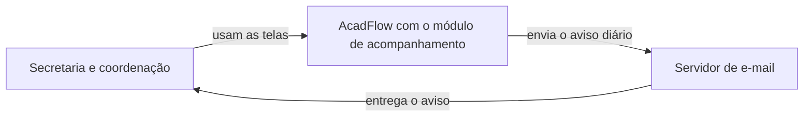
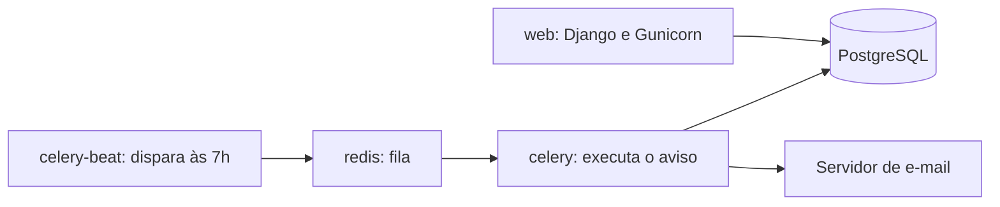
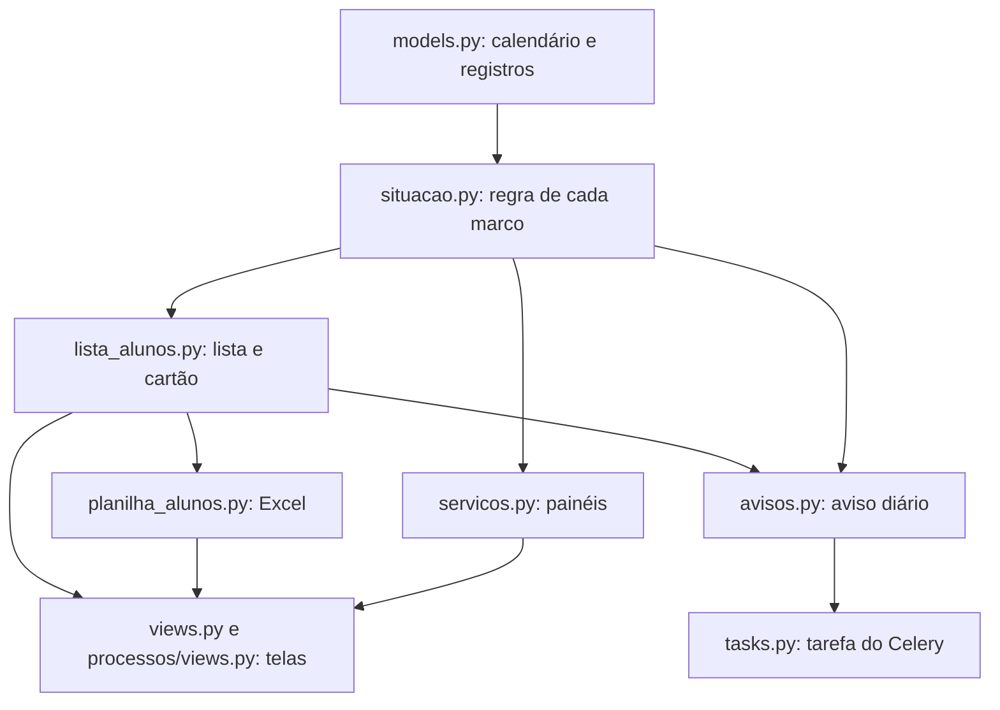

# Documento técnico: módulo de acompanhamento acadêmico

Equipe E4. Situação em 21/11/2026, versão 1.4.1 do AcadFlow, igual na `main` do repositório oficial e na `develop` do fork da equipe.

Este documento é para quem vai instalar, operar ou continuar o módulo. O que o módulo é, para quem e as regras que ele segue estão no [documento de negócio](documento-de-negocio.md). O que ficou pendente está na [passagem de conhecimento](passagem-de-conhecimento.md). O uso das telas está no [manual da secretaria](manual-de-uso-secretaria.md).

## Histórico

| Data | O que mudou |
|---|---|
| 02/11/2026 | Documento criado com a primeira entrega completa do módulo: lista por marco, planilha, aviso diário, calendário e painéis |
| 03/11/2026 | Módulo em produção na versão 1.4.0, com as chaves desligadas |
| 09/11/2026 | Painel por Professor, taxas do Painel de Sucesso por Turma que somam 100% e versões fixas no `requirements.txt` |
| 16/11/2026 | O coordenador publicou a versão 1.4.1: Redis e `kombu` compatíveis, conferência das dependências no build, Dashboard aberto pela página de Acompanhamento e textos com flexão de gênero |
| 21/11/2026 | Documento passa a tratar só da parte técnica. As regras de negócio foram para o documento de negócio, e os riscos e pendências, para a passagem de conhecimento |

## 1. Visão geral

O módulo acrescenta ao AcadFlow o acompanhamento dos prazos dos alunos de mestrado e doutorado e os painéis pedidos pela coordenação. Ele chega desligado. Com a chave desligada, as telas novas respondem como página inexistente e o menu não muda.

| Tela ou serviço | Endereço |
|---|---|
| Página de Acompanhamento | `/acompanhamento/` |
| Cartão "Alunos irregulares" | Página inicial do sistema |
| Lista de alunos por marco e planilha | `/coordenacao/alunos/`, tela original com filtros novos |
| Painel de Sucesso por Turma | `/acompanhamento/painel-sucesso-turma/` |
| Painel de Processos | `/acompanhamento/processos/` |
| Painel de Docentes | `/acompanhamento/docentes/` |
| Painel por Professor | `/acompanhamento/professores/` |
| Calendário de Marcos | `/acompanhamento/calendario-marcos/` |
| Dashboard | `/coordenacao/dashboard/`, tela original, aberta pelo cartão da página de Acompanhamento |
| Aviso diário | Tarefa do Celery, às 7h, horário de Recife |

## 2. Onde o módulo se encaixa



O módulo não usa serviço novo. Ele roda nos contêineres que o sistema já tem:



O `requirements.txt` fixa a versão de todas as dependências, inclusive as indiretas. Assim, uma versão nova publicada por terceiros não muda a imagem sem aviso. Desde a 1.4.1, o Celery usa `kombu[redis]==5.6.2` com `redis==6.1.0`, e o `Dockerfile` roda `pip check` e testa o transporte Redis do `kombu` durante o build. Uma combinação incompatível agora quebra o build, e não mais o worker em produção.

## 3. Como o módulo é organizado

O código fica no app `acompanhamento`. O cálculo está em um único lugar, e telas, planilha e aviso usam o mesmo resultado.



| Arquivo em `acompanhamento/` | Papel |
|---|---|
| `chave.py` | Lê as duas chaves |
| `decoradores.py` e `permissoes.py` | Regras de acesso às telas, inclusive a do Painel por Professor |
| `situacao.py` | Regras de prazo de cada marco |
| `previsao_conclusao.py` | Previsão de conclusão dos alunos ativos de um professor |
| `lista_alunos.py` | Lista por marco e cartão de irregulares |
| `planilha_alunos.py` | Arquivo Excel |
| `servicos.py` | Cálculo dos painéis |
| `avisos.py` e `tasks.py` | Aviso diário |
| `telas.py` | Cartões da página de Acompanhamento |
| `models.py` | Calendário, avisos, planilhas baixadas e execuções do aviso |
| `management/commands/` | `mostrar_aviso_do_dia` e `gerar_dados_ficticios` |

Fora do app, o código alterado é:

| Arquivo | Alteração |
|---|---|
| `ppgec/settings.py` | Registra o app e as duas chaves |
| `ppgec/urls.py` | Inclui as rotas do módulo |
| `ppgec/celery.py` | Agenda a tarefa do aviso |
| `processos/context_processors.py` | Item "Acompanhamento" no menu, só com a chave ligada. O item também fica marcado no Dashboard |
| `processos/views.py` | Filtros e planilha na lista de alunos, cartão na página inicial |
| `templates/processos/alunos_lista.html` | Campos, colunas e botão do Excel |
| `templates/processos/home.html` | Cartão de alunos irregulares |
| `static/css/app.css` | Estilos das barras de gráfico |

Para continuar o módulo:

- Uma tela nova entra na lista de `telas.py`, sem mexer no menu do sistema, e usa o decorador `tela_do_modulo`.
- Os dados de teste saem de `python manage.py gerar_dados_ficticios`. O comando recusa rodar com `DEBUG=False`.
- As decisões técnicas estão na seção 6. Antes de mudar uma regra de prazo, conferir o documento de negócio, porque as regras foram confirmadas pela coordenação.

## 4. Como ligar e desligar

| Variável no `.env` | Padrão | Efeito |
|---|---|---|
| `ACOMPANHAMENTO_ATIVO` | `False` | Liga as telas, o menu e o cartão |
| `ACOMPANHAMENTO_AVISO_ATIVO` | `False` | Liga o aviso diário. Só vale com a chave do módulo ligada |

Em 21/11/2026, o endereço `/acompanhamento/` de produção pede login em vez de responder como página inexistente, o que indica que o módulo está ligado. O estado do aviso não pôde ser conferido de fora.

### Instalação

O contêiner `web` aplica as migrations ao subir, mesmo com as chaves desligadas. O módulo tem quatro migrations, todas do app `acompanhamento`, e elas só criam tabelas novas.

| Migration | Tabela |
|---|---|
| `0001_calendario_marcos` | Calendário de marcos |
| `0002_aviso_irregularidade` | Avisos de irregularidade |
| `0003_planilhabaixada` | Registro de quem baixou cada planilha |
| `0004_execucaoaviso` | Registro de cada execução do aviso |

### Ligar o módulo

1. No `.env` do servidor, colocar `ACOMPANHAMENTO_ATIVO=True`.
2. Rodar `docker compose -f docker-compose-prod.yml up -d`. Só reiniciar os contêineres não relê o `.env`.
3. Entrar com um usuário de gestão e abrir `/acompanhamento/`.
4. Cadastrar as datas do semestre no Calendário de Marcos. Sem elas, parte dos alunos aparece como "Não foi possível calcular".

O aviso diário tem um passo a passo próprio, na [lista de verificação do servidor](verificacao-do-servidor-para-o-aviso.md).

### Desligar

1. Colocar `ACOMPANHAMENTO_ATIVO=False` no `.env`.
2. Rodar `docker compose -f docker-compose-prod.yml up -d`.

As telas voltam a responder como página inexistente, e o cartão e o menu somem. Os dados continuam nas tabelas e voltam a aparecer ao religar. Não é preciso reverter código nem migration.

Desde a 1.4.1, o Dashboard não tem mais item próprio no menu e é aberto pelo cartão da página de Acompanhamento. Com o módulo desligado, ele continua em `/coordenacao/dashboard/`, mas sem atalho no menu.

Para parar só os e-mails, basta colocar `ACOMPANHAMENTO_AVISO_ATIVO=False` e rodar o mesmo comando.

### Como atualizar a produção

O caminho do código é `develop` do fork, `homolog` do fork, `stage` do repositório oficial e `main` do repositório oficial. Os dois últimos merges são do coordenador.

1. O merge na `main` dispara o workflow "Build and push web image", que gera a imagem.
2. Em até 5 minutos, o Watchtower troca os contêineres `web`, `celery` e `celery-beat` pela imagem nova. Banco, Redis e pgAdmin não mudam.
3. Depois da troca, conferir no servidor, na pasta do `docker-compose-prod.yml`. Os comandos só leem informações e não enviam e-mail:

```
docker compose -f docker-compose-prod.yml ps
docker inspect -f '{{.Name}} {{.State.Status}} reinicios={{.RestartCount}}' ppgec_celery ppgec_celery_beat
docker compose -f docker-compose-prod.yml exec celery celery -A ppgec inspect registered | grep enviar_avisos_irregularidade
docker compose -f docker-compose-prod.yml logs --since 1h celery celery-beat | grep -i -E "unregistered|Traceback|ERROR"
```

O esperado é: os contêineres em `running`, o worker e o beat com `reinicios=0`, a tarefa `acompanhamento.tasks.enviar_avisos_irregularidade` listada e nenhuma linha no último comando.

Se uma versão nova der problema numa tela do módulo, desligar o módulo resolve sem mexer no código.

## 5. Testes e ensaio de produção

Os testes rodam com `DEBUG=True`:

```
python manage.py check
python manage.py makemigrations --check --dry-run
python manage.py test
ACOMPANHAMENTO_ATIVO=True python manage.py test processos
```

O workflow `.github/workflows/ci.yml` roda esses passos em PostgreSQL 16 e Python 3.11 a cada pull request para a `develop`. O workflow `.github/workflows/ensaio-producao.yml` parte do banco migrado com a `main` oficial, aplica as migrations novas e confere que:

- o site responde e `/acompanhamento/` dá 404 com o módulo desligado;
- as páginas principais abrem com cada perfil;
- a tarefa do aviso está registrada no worker;
- com o módulo ligado e o aviso desligado, a tarefa não faz nada;
- nenhum contêiner reiniciou e os logs não têm exceção.

O último ensaio, em 09/11/2026, passou em todos os itens. O ensaio não cobre o servidor do cliente.

## 6. Como operar

### Aviso diário

Todo dia às 7h, horário de Recife, a tarefa calcula a situação dos alunos ativos e atualiza os avisos:

- quem ficou atrasado ganha um aviso novo;
- quem saiu do atraso, mudou de situação ou deixou de estar ativo tem o aviso encerrado;
- sem aviso novo nem pendente, nenhum e-mail sai.

Para ver o e-mail do dia sem enviar nem gravar nada, com o aviso ligado ou desligado:

```
docker compose -f docker-compose-prod.yml exec web python manage.py mostrar_aviso_do_dia
```

Para gerar a prévia em arquivo, acrescentar `--html previa.html`. A saída tem nomes de alunos reais: não colar em grupo nem em issue.

### O que fazer se algo falhar

| O que aparece | Causa provável | O que fazer |
|---|---|---|
| "Último aviso rodou em" não mostra a data do dia | O worker ou o beat parou | Ver `docker ps --filter name=ppgec_celery` e os logs de `ppgec_celery` e `ppgec_celery_beat` |
| A execução mostra avisos pendentes | Falha no envio ou ninguém nos dois setores | Conferir o e-mail no `.env` e os membros dos setores. Os avisos entram no e-mail do dia seguinte |
| Os links do e-mail apontam para `localhost` | `SITE_URL` não preenchido | Preencher no `.env` e rodar `up -d` |
| Muitos alunos como "Não foi possível calcular" | Falta data no calendário ou no cadastro | Cadastrar a data do semestre ou corrigir o cadastro. Falhas de cálculo também ficam registradas no log |
| O cartão "Alunos irregulares" sumiu da página inicial | Erro no cálculo. A página continua abrindo | Ver o log `Falha ao calcular o cartão de alunos irregulares` |

Se a tarefa ficar dias sem rodar, nenhum atraso se perde: a execução seguinte compara a situação do dia com os avisos abertos e recupera tudo. Cada envio faz até três tentativas, com 30 segundos de pausa entre elas.

### Registros

O calendário, as planilhas baixadas e as execuções do aviso podem ser consultados no admin do Django.

## 7. Decisões técnicas

| Decisão | Motivo | Consequência |
|---|---|---|
| Módulo em app próprio | Reduz os conflitos com as atualizações do sistema original | Parte da lista de alunos continua em `processos/views.py` |
| Chaves desligadas por padrão | Permite instalar sem mudar nada para o usuário e voltar atrás sem reverter código | Alguém precisa ligar as chaves em cada ambiente |
| Aviso no Celery, sem n8n | O Celery já roda em produção, a regra fica em um lugar só e dias perdidos são recuperados. Informado ao coordenador em 27/10/2026 | O aviso depende do worker e do beat |
| Situação calculada na hora | Evita guardar um valor que pode ficar defasado quando o cadastro muda | Toda abertura da lista e da página inicial refaz o cálculo |
| Mesma regra de acesso da gestão do sistema | Não cria uma segunda regra para manter | O módulo usa a função privada `_has_gestao_access`, e um teste avisa se as duas cópias divergirem |
| Mesmo cálculo para cartão, lista e planilha | Os números não podem divergir entre as telas | Uma mudança na lista afeta as três saídas |
| Versões fixas no `requirements.txt` | Em 03/11/2026, uma versão nova do `kombu` derrubou o worker sem nenhuma mudança no código | Atualizar uma dependência passa a ser uma mudança explícita, com teste e ensaio |

## 8. Termos técnicos

| Termo | Significado |
|---|---|
| Chave | Variável do `.env` que liga ou desliga o módulo ou o aviso |
| Worker | Contêiner `celery`, que executa a tarefa do aviso |
| Beat | Contêiner `celery-beat`, que dispara a tarefa às 7h |
| Watchtower | Serviço do servidor que troca os contêineres quando sai imagem nova |
| Ensaio de produção | Teste com Docker que sobe o sistema como em produção, sobre o banco migrado com a `main` oficial |

Os termos de negócio estão no documento de negócio.

Documentos relacionados:

- [Documento de negócio](documento-de-negocio.md)
- [Passagem de conhecimento](passagem-de-conhecimento.md)
- [Manual de uso para a secretaria](manual-de-uso-secretaria.md)
- [Lista de verificação do servidor para o aviso](verificacao-do-servidor-para-o-aviso.md)
- [Guia do ambiente local](guia-do-ambiente-local.md)
- [Setup do ambiente e da infraestrutura](setup_ambiente_e_infraestrutura.md)
- [Como contribuir](../CONTRIBUTING.md)
