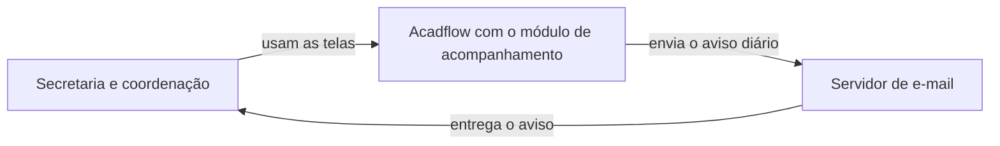
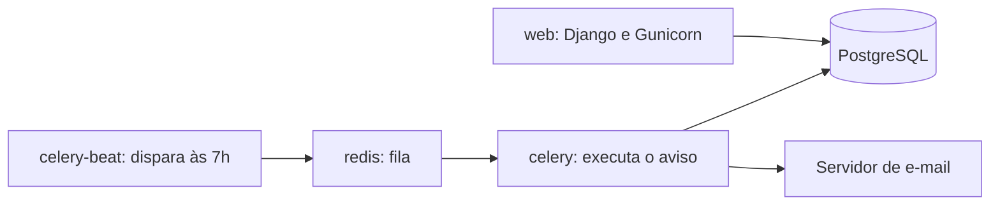
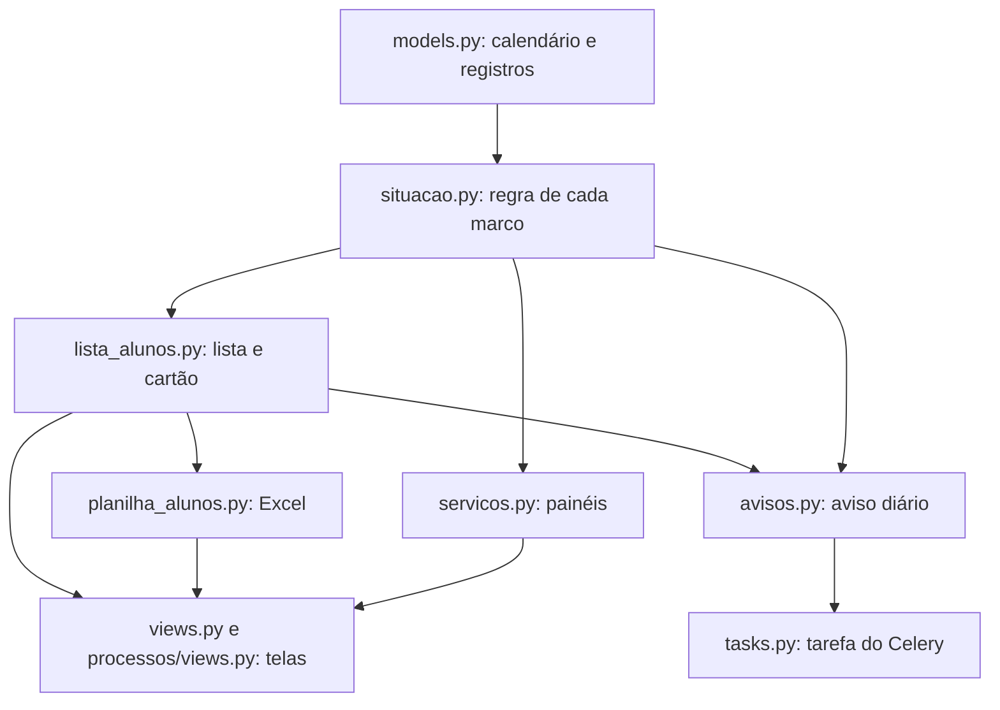

# Entrega do módulo de acompanhamento acadêmico

Equipe E4. Situação em 02/11/2026, com base na branch `develop`.

Este documento é para quem vai instalar, operar ou continuar o módulo. O uso das telas está no [manual da secretaria](manual-de-uso-secretaria.md).

## 1. Visão geral

O módulo acrescenta ao Acadflow o acompanhamento dos prazos dos alunos de mestrado e doutorado e os painéis pedidos pela coordenação do PPGEC. Ele calcula a situação de cada aluno nos marcos acadêmicos, mostra os irregulares e pode avisar a secretaria e a coordenação por e-mail.

O módulo chega desligado. Com a chave desligada, as telas novas respondem como página inexistente e o menu não muda.

| O que foi entregue | Onde fica | O que faz |
|---|---|---|
| Página de Acompanhamento | `/acompanhamento/` | Reúne as telas em cartões, mostra o total de alunos irregulares e o estado do aviso diário |
| Cartão "Alunos irregulares" | Página inicial do sistema | Mostra o total e abre a lista filtrada |
| Lista de alunos por marco | `/coordenacao/alunos/` | Tela já existente, com filtros de marco, situação e semestre, colunas novas e download em Excel |
| Painel de Sucesso por Turma | `/acompanhamento/painel-sucesso-turma/` | Gráfico de sete barras e detalhes por turma de ingresso |
| Painel de Processos | `/acompanhamento/processos/` | Processos abertos, atrasados e tempo médio no período |
| Painel de Docentes | `/acompanhamento/docentes/` | Distribuição por polo, permanentes e colaboradores |
| Calendário de Marcos | `/acompanhamento/calendario-marcos/` | Cadastro das datas de projeto e qualificação por semestre |
| Aviso diário | E-mail às 7h, horário de Recife | Avisa a Secretaria PPGEC e a Coordenação PPG sobre alunos que ficaram atrasados |

A página de Acompanhamento também leva à Carga de Orientação, que é uma tela original do sistema.

## 2. Onde o módulo se encaixa



O módulo não usa serviço novo. Ele roda nos contêineres que o sistema já tem:



Em relação à `main` do repositório oficial (`b4fd0d0`), a entrega não altera `requirements.txt`, `Dockerfile` nem os arquivos do Docker Compose.

## 3. Como o módulo é organizado

O código fica no app `acompanhamento`. O cálculo está em um único lugar, e telas, planilha e aviso usam o mesmo resultado.



| Arquivo em `acompanhamento/` | Papel |
|---|---|
| `chave.py` | Lê as duas chaves |
| `decoradores.py` e `permissoes.py` | Regras de acesso às telas |
| `situacao.py` | Regras de prazo |
| `lista_alunos.py` | Lista por marco e cartão de irregulares |
| `planilha_alunos.py` | Arquivo Excel |
| `servicos.py` | Cálculo dos painéis |
| `avisos.py` e `tasks.py` | Aviso diário |
| `telas.py` | Cartões da página de Acompanhamento |
| `models.py` | Calendário, avisos, planilhas baixadas e execuções do aviso |
| `management/commands/` | `mostrar_aviso_do_dia` e `gerar_dados_ficticios` |

Fora do app, o código alterado é:

| Arquivo | Alteração |
|---|---|
| `ppgec/settings.py` | Registra o app e as duas chaves |
| `ppgec/urls.py` | Inclui as rotas do módulo |
| `ppgec/celery.py` | Agenda a tarefa do aviso |
| `processos/context_processors.py` | Item "Acompanhamento" no menu, só com a chave ligada |
| `processos/views.py` | Filtros e planilha na lista de alunos, cartão na página inicial |
| `templates/processos/alunos_lista.html` | Campos, colunas e botão do Excel |
| `templates/processos/home.html` | Cartão de alunos irregulares |
| `static/css/app.css` | Estilos das barras de gráfico |

Para continuar o módulo:

- Uma tela nova entra na lista de `telas.py`, sem mexer no menu do sistema, e usa o decorador `tela_do_modulo`.
- Os dados de teste saem de `python manage.py gerar_dados_ficticios`. O comando recusa rodar com `DEBUG=False`.
- Os testes rodam com `DEBUG=True`: `python manage.py test` e, com o módulo ligado, `ACOMPANHAMENTO_ATIVO=True python manage.py test processos`.

## 4. Como ligar e desligar

| Variável no `.env` | Padrão | Efeito |
|---|---|---|
| `ACOMPANHAMENTO_ATIVO` | `False` | Liga as telas, o menu e o cartão |
| `ACOMPANHAMENTO_AVISO_ATIVO` | `False` | Liga o aviso diário. Só vale com a chave do módulo ligada |

### Instalação

O contêiner `web` aplica as migrations ao subir, mesmo com as chaves desligadas. A entrega traz quatro migrations, todas do app `acompanhamento`, e elas só criam tabelas novas.

| Migration | Tabela |
|---|---|
| `0001_calendario_marcos` | Calendário de marcos |
| `0002_aviso_irregularidade` | Avisos de irregularidade |
| `0003_planilhabaixada` | Registro de quem baixou cada planilha |
| `0004_execucaoaviso` | Registro de cada execução do aviso |

### Ligar o módulo

1. No `.env` do servidor, colocar `ACOMPANHAMENTO_ATIVO=True`.
2. Rodar `docker compose -f docker-compose-prod.yml up -d`. Só reiniciar os contêineres não relê o `.env`.
3. Entrar com um usuário de gestão e abrir `/acompanhamento/`.
4. Cadastrar as datas do semestre no Calendário de Marcos. Sem elas, parte dos alunos aparece como "Não foi possível calcular".

O aviso diário tem um passo a passo próprio, na [lista de verificação do servidor](verificacao-do-servidor-para-o-aviso.md).

### Desligar

1. Colocar `ACOMPANHAMENTO_ATIVO=False` no `.env`.
2. Rodar `docker compose -f docker-compose-prod.yml up -d`.

As telas voltam a responder como página inexistente, e o cartão e o menu somem. Os dados continuam nas tabelas e voltam a aparecer ao religar. Não é preciso reverter código nem migration.

Para parar só os e-mails, basta colocar `ACOMPANHAMENTO_AVISO_ATIVO=False` e rodar o mesmo comando.

### Como a entrega foi conferida

A cada pull request para a `develop`, o CI roda os testes em PostgreSQL 16 e Python 3.11. O ensaio de produção parte do banco migrado com a `main` do repositório oficial, aplica as migrations novas e confere que:

- o site responde e `/acompanhamento/` dá 404 com o módulo desligado;
- as páginas principais abrem com cada perfil;
- a tarefa do aviso está registrada no worker;
- com o módulo ligado e o aviso desligado, a tarefa não faz nada;
- nenhum contêiner reiniciou e os logs não têm exceção.

O último ensaio na `develop` passou em 02/11/2026. O ensaio não cobre o servidor do cliente (ver seção 8).

## 5. Como operar

### Aviso diário

Todo dia às 7h, horário de Recife, a tarefa calcula a situação dos alunos ativos e atualiza os avisos:

- quem ficou atrasado ganha um aviso novo;
- quem saiu do atraso, mudou de situação ou deixou de estar ativo tem o aviso encerrado;
- sem aviso novo nem pendente, nenhum e-mail sai.

O primeiro e-mail é o levantamento inicial, com todos os alunos que já estavam atrasados. Os destinatários são os membros atuais e ativos da Secretaria PPGEC e da Coordenação PPG que têm e-mail cadastrado.

Para ver o e-mail do dia sem enviar nem gravar nada, com o aviso ligado ou desligado:

```
docker compose -f docker-compose-prod.yml exec web python manage.py mostrar_aviso_do_dia
```

Para gerar a prévia em arquivo, acrescentar `--html previa.html`.

### O que fazer se algo falhar

| O que aparece | Causa provável | O que fazer |
|---|---|---|
| "Último aviso rodou em" não mostra a data do dia | O worker ou o beat parou | Ver `docker ps --filter name=ppgec_celery` e os logs de `ppgec_celery` e `ppgec_celery_beat` |
| A execução mostra avisos pendentes | Falha no envio ou ninguém nos dois setores | Conferir o e-mail no `.env` e os membros dos setores. Os avisos entram no e-mail do dia seguinte |
| Os links do e-mail apontam para `localhost` | `SITE_URL` não preenchido | Preencher no `.env` e rodar `up -d` |
| Muitos alunos como "Não foi possível calcular" | Falta data no calendário ou no cadastro | Cadastrar a data do semestre ou corrigir o cadastro. Falhas de cálculo também ficam registradas no log |
| O cartão "Alunos irregulares" sumiu da página inicial | Erro no cálculo. A página continua abrindo | Ver o log `Falha ao calcular o cartão de alunos irregulares` |

Se a tarefa ficar dias sem rodar, nenhum atraso se perde: a execução seguinte compara a situação do dia com os avisos abertos e recupera tudo.

Cada envio faz até três tentativas, com 30 segundos de pausa entre elas.

### Registros

A planilha baixada fica registrada com quem baixou, quando e com quais filtros. Esse registro pode ser consultado no admin do Django, junto com o calendário.

## 6. Regras de negócio

As regras estão em `acompanhamento/situacao.py`. Elas foram confirmadas com a secretaria em 12/10/2026 e com a coordenação em 16/10/2026. Os três estados vêm da reunião de 27/10/2026.

### Estados na tela

| Estado | Quando aparece |
|---|---|
| Irregular | Atraso no marco, com ou sem nova chance. O motivo explica o caso |
| Regular | Em dia ou com o marco já cumprido |
| Não foi possível calcular | Falta dado para o cálculo, ou o cálculo falhou naquele cadastro |

Só entra a trajetória ativa de mestrado ou doutorado. Quem já defendeu não aparece na lista da defesa.

### Projeto de dissertação e qualificação

- **Mestrado:** vale a data limite do projeto na trajetória. Sem ela, vale a data do calendário para o semestre do projeto.
- **Doutorado:** vale a data do calendário para o semestre da qualificação, que por padrão é o quinto.
- **Trancamento:** os dias trancados somam à data limite.
- **Conceito A ou B:** marco cumprido.
- **Conceito C:** uma única repetição, em até 3 meses (mestrado) ou 6 meses (doutorado).
- **Conceito D:** irregular, sem nova chance.
- **Sem apresentação até a data:** uma nova chance, no mesmo prazo de 3 ou 6 meses. Se esse prazo passar, ou se apresentar nele e não for aprovado, fica irregular sem nova chance.

### Defesa

O prazo termina no último dia do mês em que se completam 24 meses (mestrado) ou 48 meses (doutorado) do mês de ingresso. As prorrogações somam meses e valem até o fim do mês em que terminam. Depois, somam-se os dias de trancamento.

Exemplo: ingresso em fevereiro de 2025, no mestrado, com 3 meses de prorrogação, tem limite em 31/05/2027.

### Painel de Sucesso por Turma

A turma é o semestre de ingresso. As barras são Concluídos, Desligados, Trancados, Ativos, Ativos regulares, Ativos irregulares e Com prorrogação, sempre em percentual dos ingressantes da turma. Trajetórias removidas ou em homologação ficam de fora.

Ativo irregular é quem está irregular no marco ou na defesa. Ativos regulares inclui quem aparece como "Não foi possível calcular" na lista, e a tela informa isso.

Turmas anteriores a 2026.2 aparecem com aviso, porque desligamentos, prorrogações e defesas dessas turmas podem não ter sido lançados.

### Diferença conhecida

A página do aluno, do sistema original, conta a prorrogação mantendo o dia. No exemplo acima, ela mostra 28/05/2027, e o módulo mostra 31/05/2027. O módulo segue a resposta da coordenação, e a página do aluno não foi alterada.

## 7. Decisões

| Decisão | Motivo | Consequência |
|---|---|---|
| Módulo em app próprio | Reduz os conflitos com as atualizações do sistema original | Parte da lista de alunos continua em `processos/views.py` |
| Chaves desligadas por padrão | Permite instalar sem mudar nada para o usuário e voltar atrás sem reverter código | Alguém precisa ligar as chaves em cada ambiente |
| Aviso no Celery, sem n8n | O Celery já roda em produção, a regra fica em um lugar só e dias perdidos são recuperados. Informado ao professor em 27/10/2026 | O aviso depende do worker e do beat |
| Situação calculada na hora | Evita guardar um valor que pode ficar defasado quando o cadastro muda | Toda abertura da lista e da página inicial refaz o cálculo |
| Mesma regra de acesso da gestão do sistema | Não cria uma segunda regra para manter | Servidor, bolsista e voluntário também veem as telas (ver seção 8) |
| Mesmo cálculo para cartão, lista e planilha | Os números não podem divergir entre as telas | Uma mudança na lista afeta as três saídas |

## 8. Riscos, pendências e o que ficou de fora

### Conferir antes de ligar em produção

| Item | Por que importa | Quem decide ou confere |
|---|---|---|
| Contas de teste no banco | A migration `0003_seed_mock_data`, do sistema original, cria o "Aluno Mock 1". Se ele existir em produção, entra no cartão, na lista e no aviso | Equipe confere, coordenação decide a remoção |
| Quem pode ver as telas | A lista e a planilha têm dados pessoais. Hoje, servidor, bolsista e voluntário também veem | Coordenação |
| Números e lista | A secretaria e a coordenação precisam validar os números com dados reais | Secretaria e coordenação |
| E-mail e Celery no servidor | Nada disso foi conferido no servidor do cliente | Equipe e DTI, com a lista de verificação |

### Limitações conhecidas

- As taxas de cada turma são arredondadas uma a uma, e a soma pode dar 99,9% ou 100,1%.
- O início dos registros (2026.2) está fixo em `servicos.py`.
- A lista considera a trajetória ativa mais recente do aluno, e o painel conta todas as ativas. Os números só divergem se um aluno tiver duas trajetórias ativas.
- O desempenho do Painel de Processos com muitos dados não foi medido.
- O módulo usa uma função privada do sistema, `_has_gestao_access`. Um teste avisa se as duas cópias dessa regra divergirem.

### Pedidos que não entraram

Pedidos da coordenação ainda sem definição de prioridade:

- taxa de sucesso de defesa por professor;
- taxa de prorrogação por professor;
- alunos por professor em cada semestre, com previsão de conclusão;
- sucesso por turma filtrado por professor;
- curvas semestre a semestre;
- melhoria da página de Dashboard.

### Fora do escopo

- Integração com n8n.
- Tela de Planejamento Estratégico.
- Reorganização do app `processos`.
- Correções no código original, que são tratadas diretamente com o professor.

## 9. Glossário e links

| Termo | Significado |
|---|---|
| Trajetória | Passagem do aluno por um curso, com nível, ingresso, orientador e status |
| Turma | Alunos com o mesmo semestre de ingresso, como 2025.1 |
| Marco | Projeto de dissertação (mestrado), qualificação (doutorado) ou defesa |
| Data limite | Último dia para cumprir o marco, já com trancamentos e prorrogações, quando for o caso |
| Reapresentação | Nova chance depois da data limite ou de um conceito C |
| Prorrogação | Meses acrescentados ao prazo da defesa |
| Trancamento | Período de suspensão, cujos dias somam aos prazos |
| Levantamento inicial | Primeiro e-mail do aviso, com todos os atrasados daquele momento |
| Chave | Variável do `.env` que liga ou desliga o módulo ou o aviso |

Documentos relacionados:

- [Manual de uso para a secretaria](manual-de-uso-secretaria.md)
- [Lista de verificação do servidor para o aviso](verificacao-do-servidor-para-o-aviso.md)
- [Guia do ambiente local](guia-do-ambiente-local.md)
- [Setup do ambiente e da infraestrutura](setup_ambiente_e_infraestrutura.md)
- [Como contribuir](../CONTRIBUTING.md)
